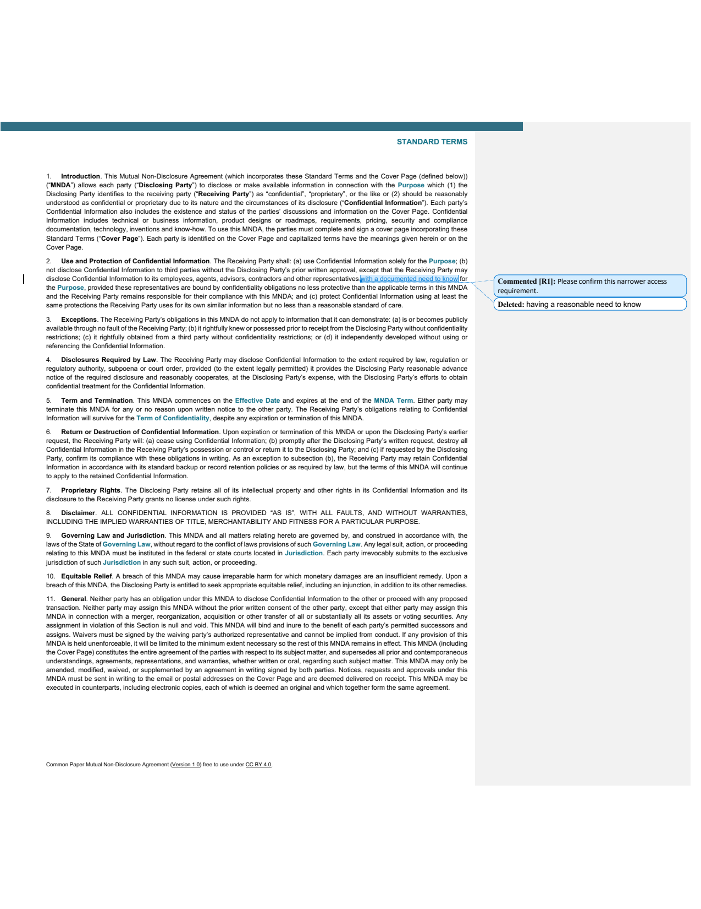

# Your first document review

[Back to the README](../README.md)

This walkthrough changes one phrase in a sample NDA and adds a comment. You finish with an original and a separate Word file containing pending revisions.

## With an agent

1. Run `npx skills add kklimuk/docx-cli` in your terminal and select your agent. This installer requires Node/npm. For a manual install or the standalone binary, see [installation](installation.md).
2. Download [mnda.docx](https://raw.githubusercontent.com/kklimuk/docx-cli/main/tests/fixtures/mnda.docx) into the folder your agent can access. This is the Common Paper Mutual NDA v1.0; its attribution is retained in the document.
3. Start a new agent session if the installed skill is not yet visible, and paste:

> Use the docx-cli skill to edit mnda.docx. Save a copy as mnda-reviewed.docx and keep the original unchanged. Turn on tracked changes. Replace “having a reasonable need to know” with “with a documented need to know”. Add a comment on the new wording: “Please confirm this narrower access requirement.” Keep the rest of the document unchanged and leave the revisions pending for review.

The skill's bootstrap installs the binary if needed. Follow any installation or PATH instructions it reports. The agent needs permission to read and write files in this folder.

## From the terminal

After [installing the binary](installation.md), run these commands in a new folder (macOS/Linux shell). The filenames below should not already contain work you want to keep.

```sh
curl -fL https://raw.githubusercontent.com/kklimuk/docx-cli/main/tests/fixtures/mnda.docx -o mnda.docx
cp mnda.docx mnda-reviewed.docx

docx track-changes on mnda-reviewed.docx
docx replace mnda-reviewed.docx \
  "having a reasonable need to know" "with a documented need to know"
docx comments add mnda-reviewed.docx \
  --anchor "with a documented need to know" \
  --text "Please confirm this narrower access requirement."
```

Expected output includes `tracking on`, `1 occurrence replaced`, and a comment ID such as `c0`. The command is **`track-changes on FILE`**: the action comes before the filename.

## Check the result

Open `mnda-reviewed.docx` in Microsoft Word. Under **Review**, select **All Markup**, then find the **Use and Protection of Confidential Information** clause. The original phrase should be marked as deleted, the new phrase inserted, and a comment attached to the change. The template's remaining placeholders are intentionally untouched.



You can inspect the review without Word:

```sh
docx track-changes list mnda-reviewed.docx
docx comments list mnda-reviewed.docx
docx read mnda-reviewed.docx --current --comments
docx validate mnda-reviewed.docx
```

`--current` shows pending insertions/deletions; the default read view shows what the text would look like after accepting them. `validate` checks supported document parts against the OOXML schema; it does not prove visual fidelity.

To accept the changes into a **third file**, preserving your review copy:

```sh
docx track-changes accept mnda-reviewed.docx --all -o mnda-accepted.docx
```

To render page images, install Word or LibreOffice, then run:

```sh
docx render mnda-reviewed.docx --out preview
```

Reading, editing, comments, and tracked changes do not require either application.

## Troubleshooting

| Symptom | What to do |
| --- | --- |
| `docx: command not found` after standalone installation | Run `export PATH="$HOME/.local/bin:$PATH"` in the current shell; add that directory to your shell configuration for future sessions. If you set `PREFIX`, use that directory instead. |
| Agent cannot find the skill | Restart the agent session and confirm you selected the right agent/project in the skills installer. See [manual setup](installation.md#use-as-an-agent-skill). |
| Phrase not found on a second attempt | Start again from a fresh copy of `mnda.docx`; the first run already replaced it. |
| No visible redlines in Word | Select **All Markup** and confirm you opened `mnda-reviewed.docx`, not the original or accepted copy. |
| `bun` is missing | Use the standalone binary; only the `bun add` / `bunx` route requires Bun. |
| Rendering fails | Confirm Word or LibreOffice is installed. Other document operations can still run. |

For your own documents, keep a source copy, describe the exact requested changes, and review the output before using it. [Command reference](reference.md).
